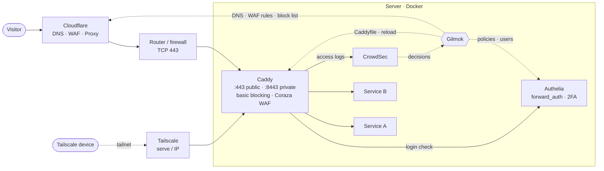
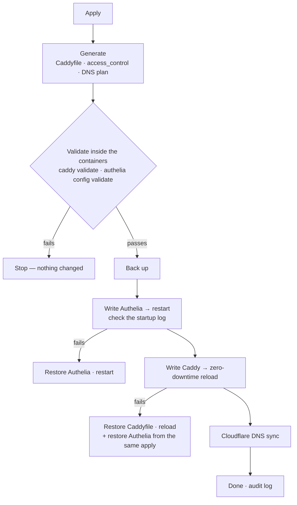

<div align="center">

# Gilmok · 길목

**One web UI for a Caddy + Authelia + Cloudflare + CrowdSec + Tailscale reverse proxy.**

Add a service and Gilmok generates the Caddyfile, login policy, DNS record and WAF rules together —<br>
then **validates → backs up → applies without downtime → checks health → rolls back automatically on failure**.

[](LICENSE)

[](https://hub.docker.com/r/vitive/gilmok)


[한국어](README.md) · **English**

</div>

> **Gilmok (길목)** is Korean for the spot where a wide road narrows into an alley — the one place every request to your home server passes through.

---

## Contents

- [Why](#why)
- [Features](#features)
- [How it fits together](#how-it-fits-together)
- [Safe apply](#safe-apply)
- [Quick start](#quick-start)
- [Pick your components](#pick-your-components)
- [Security model](#security-model)
- [Environment variables](#environment-variables)
- [Languages](#languages)
- [Development](#development)
- [FAQ](#faq)
- [License](#license)

## Why

Once a homelab grows to ten or twenty services, adding one more means:

1. a new site block in the Caddyfile (public? Tailscale-only? mTLS?)
2. a rule in Authelia's `access_control`, maybe a change to `users_database.yml`
3. a DNS record in Cloudflare (Proxied? DNS only? Tailscale IP?)
4. protection settings such as WAF and CrowdSec
5. a reload or restart — and rolling back by hand if something breaks

Miss one step and the site doesn't open — or worse, it **opens without a login.**
Gilmok turns that into **one service = one row of settings**, shows you exactly what will change, and applies it safely.

## Features

### Services (reverse proxy)
- Per subdomain: **public (:443) / private (Tailscale · VPN only)**, Cloudflare **Proxied / DNS only**, **mTLS** (Authenticated Origin Pulls), Authelia **1-factor / 2-factor + allowed groups**, WAF mode
- **Bulk import from Excel (.xlsx) / CSV** — fill in the template, preview the adds/changes/deletes, apply them at once
- **Pick the upstream from your containers** — choose a Docker container and port; Gilmok works out whether it's on Caddy's network or a published port
- **Diagram** — internet → Cloudflare → router/firewall → Caddy → services, drawn from your real setup; routes to services that don't respond turn into still dashed lines

### Caddy
- **Import** an existing Caddyfile (global options and snippets → base configuration, sites → services)
- The base configuration is kept apart from services, so **Caddy image updates are applied separately**
- **Basic blocking**: scanners, attack tools, AI-crawler User-Agents and probe paths like `/.env` get a 403 at the front of Caddy
- **Coraza WAF + OWASP CRS**: off / detect / block per service, paranoia level, anomaly threshold, rule groups and exceptions, block log and test requests
- Three ways to reach Caddy: Docker container / Caddy admin API (:2019) / the caddy executable on the same PC

### Authelia
- Generates `access_control` rules per service — **only the access_control block** of `configuration.yml` is rewritten; comments, `{{ secret }}` templates, OIDC and the notifier are left alone
- User management (argon2id) and **predefined groups** — allowed groups can only be picked from registered ones, so a typo can't silently remove protection

### Cloudflare
- Automatic DNS records (create, update, delete, Proxied toggle, Tailscale IP) plus direct editing of records unrelated to services
- **DDNS Updater** (IPv4 · IPv6) — only fixes record addresses when your public IP changes
- **Edge WAF rules**: trusted IPs, threat blocking (scanners, AI crawlers and attack paths in a single rule), country · ISP (ASN) restriction, custom rules, rate limiting — with plan-limit checks
- Edge events (requests Cloudflare blocked)

### CrowdSec (Cloudflare-integrated)
- Decides on attack IPs from mTLS sites' access logs (the real IP passed on by Cloudflare) → **blocks them at the Cloudflare edge via an IP list**
- Works even where the server can't see visitor IPs, as with Docker Desktop (see the [FAQ](#faq))

### Observe · operate
- **Dashboard**: requests per minute, 5xx rate, p95 response time, status-code trends, a response-time scatter plot (drag to list the requests), service status map, container resources, certificate expiry — add, edit and rearrange widgets
- **Logs**: audit (who changed what), security · intrusion detection, system, requests, metrics — SQLite with retention and disk protection
- **Image update notices** and in-app updates (compose-based), settings backup/restore, full reset
- **Managed stacks**: no Caddy, Authelia or CrowdSec yet? Gilmok installs them as sibling containers and wires up the connection (compose editable)
- **Setup wizard / quick setup**: finds containers, config files, the domain and the Tailscale IP and lets you start from one screen

### UI
- Dark + glassmorphism, **system / dark / light** themes, keyboard and screen-reader friendly (focus traps, ARIA)
- Vanilla HTML/CSS/JS with no build step — embedded in the binary

## How it fits together



**Gilmok's data (`/data/gilmok.json`) is the source of truth.** The Caddyfile and Authelia's `access_control` block are *generated*.
Editing the Caddyfile by hand gets overwritten on the next apply (a banner at the top of the file says so). Global options and snippets are edited under “Base configuration” in the UI.

## Safe apply

Saving changes nothing. Changes pile up as “pending”, and real files, containers and DNS only change **after you press “Apply” and review the preview (diff + DNS plan).**



- Files are **written in place** (no rename), so single-file bind mounts like `./Caddyfile:/etc/caddy/Caddyfile` stay correct
- If the current file can't be read there is nothing to roll back to, so the apply stops
- DNS changes that would **change the address of public records are held by default** — protects against Gilmok running on another network (a test PC) and pointing everything at the wrong IP
- All rollback paths were verified on the test stack by injecting faults on purpose (`GM_DEV_FAULTS`, test stack only)

## Quick start

The image is [`vitive/gilmok`](https://hub.docker.com/r/vitive/gilmok) on Docker Hub (linux/amd64 · linux/arm64).

### Simplest — one file

```bash
mkdir gilmok && cd gilmok
curl -fsSLO https://github.com/redstar-programmer/gilmok/releases/latest/download/docker-compose.yml
docker compose up -d
```

No `.env` needed. It starts empty: Quick setup can install Caddy, Authelia and CrowdSec for you, or uncomment the marked lines to manage the Caddy / Authelia you already run. The file is [`deploy/docker-compose.sample.yml`](deploy/docker-compose.sample.yml) and is attached to every release.

### docker compose + .env (folders and names for your setup)

```bash
mkdir -p ~/gilmok/secrets && cd ~/gilmok
curl -fsSLO https://raw.githubusercontent.com/redstar-programmer/gilmok/main/deploy/docker-compose.yml
curl -fsSL https://raw.githubusercontent.com/redstar-programmer/gilmok/main/deploy/.env.example -o .env
touch secrets/cf_token secrets/crowdsec_key    # otherwise Docker creates them as folders
$EDITOR .env                                   # Caddy/Authelia folders, container names, network, language
docker network create reverseproxy 2>/dev/null || true
docker compose up -d
```

Update with `docker compose pull && docker compose up -d`. To pin a version set `GM_IMAGE=vitive/gilmok:0.2.0` in `.env`.

<details>
<summary>Build from source instead</summary>

```bash
git clone https://github.com/redstar-programmer/gilmok.git src
cp src/deploy/docker-compose.build.yml .
docker compose -f docker-compose.yml -f docker-compose.build.yml up -d --build   # the build also runs go test
```
</details>

### Windows install script (Docker Desktop)

```powershell
git clone https://github.com/redstar-programmer/gilmok.git D:\src\gilmok
cd D:\src\gilmok
powershell -ExecutionPolicy Bypass -File .\deploy\install.ps1 -Target D:\Docker\gilmok `
    -CaddyDir D:\Docker\caddy -AutheliaDir D:\Docker\authelia -CaddyContainer caddy -Network reverseproxy -Lang en
```

It pulls the Docker Hub image (`-Build` builds from source instead). The options are saved in `.env`, so updating later is just `install.ps1 -Target D:\Docker\gilmok`. Details (in Korean) in [deploy/README.md](deploy/README.md).

### First login

1. On the server, open **http://127.0.0.1:8088** — the admin UI listens on `127.0.0.1` only by default
2. **Choose the language** (한국어 / English) — every screen of this install uses it (skipped when `GM_LANG` is set; change it later in the Settings tab)
3. Sign in with `admin` / `admin` → you immediately create **your own administrator account**, and the initial account is disabled for good
4. **Quick setup** or the **setup wizard** — finds containers, the Caddyfile, Authelia config, the domain and the Tailscale IP. No Caddy, Authelia or CrowdSec yet? Install them from here
5. Review the services, then “Apply” → preview → apply
6. (Optional) to use it from your phone, register Gilmok itself as a Tailscale-only site with Authelia 2FA (Settings › Access security › Create Gilmok site)


## Pick your components

You don't need all of them. Turn on only what you use in Settings › Components; the rest have their tabs, settings and apply steps hidden, and Gilmok leaves them alone.

| Example | What Gilmok does |
|---|---|
| Caddy only | Generates, validates and applies the Caddyfile without downtime; basic blocking · WAF; dashboard |
| Caddy + Authelia | the above + login gates, policies and users per service |
| Caddy + Cloudflare | the above + DNS automation, DDNS, edge WAF rules, mTLS |
| Cloudflare only | DNS records, DDNS, edge rules |
| All + CrowdSec + Tailscale | CrowdSec decides, the Cloudflare edge blocks, private sites over Tailscale |

Switches that would remove protection (turning off Cloudflare while mTLS services exist, and so on) ask again with a red warning.

## Security model

Gilmok can change your proxy, SSO, DNS and WAF, so it is locked down in layers.

| Layer | What it does |
|---|---|
| Access route | Only direct host-port access (127.0.0.1) or requests carrying a **secret header** Caddy adds to the Gilmok site — other containers on the same Docker network are refused |
| SSO | Through Caddy, Authelia's `Remote-User` is required, optionally limited to groups |
| Accounts · roles | One account per person; administrator / operator / view-only + custom roles; 7 permissions |
| Two-factor | TOTP + recovery codes, can be required per account, codes can't be reused |
| Re-authentication | Apply, user changes, log deletion and security settings need the password again within N minutes |
| Lockout | Exponential lockout per account/IP plus a global one |
| Audit | Every write records who, what, and before/after values (secrets shown as `***`) |
| Secrets | Tokens, hashes and session secrets never appear in responses or logs |

> ⚠ **Do not expose the admin UI to the internet.** For remote access use a private network (Tailscale etc.) + an Authelia-protected site.
> Gilmok talks to the Docker socket, so a Gilmok account is effectively server admin.

Penetration-test scenarios (route bypass, privilege escalation, lockout evasion, session forgery, injection, secret leaks) are part of the [automated tests](docs/TEST_SCENARIOS.md).

## Environment variables

These are first-start defaults; afterwards the settings in the UI are the source of truth. With compose they go in `.env` (`GM_IMAGE` picks the image and version).

| Variable | Default | Description |
|---|---|---|
| `GM_DATA` | `/data` | Data folder (settings, log DB, backups, managed stacks) |
| `GM_LISTEN` | `:8080` | Listen address |
| `GM_LANG` | | UI language `ko` / `en` — empty: chosen on the first visit |
| `GM_DOMAIN` | | Base domain (e.g. `example.com`) |
| `GM_TAILSCALE_IP` | | DNS value of private services (e.g. `100.64.0.10`) |
| `GM_CADDY_CONTAINER` / `GM_AUTHELIA_CONTAINER` / `GM_CROWDSEC_CONTAINER` | `caddy` / `authelia` / `crowdsec` | Container names |
| `GM_CADDYFILE` | | Caddyfile path Gilmok reads and writes |
| `GM_AUTHELIA_CONFIG` / `GM_AUTHELIA_USERS` | | Authelia `configuration.yml` / `users_database.yml` |
| `GM_CROWDSEC_LAPI` | | CrowdSec LAPI address (e.g. `http://crowdsec:8080`) |
| `GM_CF_TOKEN_FILE` / `GM_CF_TOKEN` | | Cloudflare API token (file preferred). Can also be entered in the UI |
| `GM_CROWDSEC_KEY_FILE` / `GM_CROWDSEC_KEY` | | CrowdSec bouncer key. Can also be created in the UI |
| `GM_SELF_CONTAINER` | auto | Gilmok's own container name (if auto-detection fails) |

Cloudflare token permissions: `Zone · Zone · Read`, `Zone · DNS · Edit` (+ WAF rules: `Zone · Zone WAF · Edit`, edge events: `Zone · Analytics · Read`, CrowdSec list: `Account · Account Filter Lists · Edit`). The token is checked against Cloudflare before it is saved.

## Languages

The UI comes in **Korean** and **English**. The language is a **per-install setting**: chosen on the first visit (or with `GM_LANG`), every user of that install sees it, and it can be changed later in **Settings › UI language**.

- The Korean source text is the message id (gettext style). `web/i18n/ko.json` is the catalog extracted from the sources, `web/i18n/en.json` the English translation
- **Adding a language**: copy `ko.json` to `xx.json`, translate the values, and add its name to `LANGS` in `web/i18n.js`
- Generated files (Caddyfile comments etc.) stay in Korean

```bash
go run ./tools/i18n              # rebuild ko.json from the sources + report coverage
go run ./tools/i18n -missing en  # messages not translated yet
go run ./tools/i18n -sync        # drop translations whose message is gone
```

## Development

```bash
go test ./...                                             # unit · scenario · penetration tests
bash dev/reset.sh                                         # create test-stack data (dev/run, git-ignored)
docker compose -f dev/docker-compose.yml up -d --build    # http://127.0.0.1:18088
```

The test stack runs real Caddy (with Coraza), Authelia and CrowdSec containers under different names, with `local_certs`, so nothing calls out to the internet.

```
.
├── *.go                 backend (single binary, Go 1.22+ ServeMux)
│   ├── apply.go         apply pipeline · rollback
│   ├── caddy.go         Caddyfile import · generation
│   ├── authelia.go      access_control · users
│   ├── cloudflare.go    DNS · cfwaf.go edge rules · ddns.go
│   ├── crowdsec.go      LAPI → Cloudflare list sync
│   ├── stacks*.go       managed stacks (sibling containers)
│   └── security.go      access routes · sessions · lockout · accounts.go accounts/roles/TOTP
├── web/                 UI (vanilla JS, embedded) · web/i18n language files
├── tools/i18n/          catalog extraction tool
├── deploy/              deploy compose · install.ps1 · Caddy (Coraza) Dockerfile · CrowdSec parser
├── dev/                 test stack
└── docs/                design notes · test scenarios
```

Code comments and docs under `docs/` are mostly in Korean.

### Releases (maintainers)

`git tag v0.2.0 && git push origin v0.2.0` → GitHub Actions (`.github/workflows/docker.yml`) runs the tests and pushes amd64 · arm64 images as `vitive/gilmok:0.2.0`, `:0.2` and `:latest`. It needs the repository secrets `DOCKERHUB_USERNAME` and `DOCKERHUB_TOKEN` (a Docker Hub access token with Read & Write). Every push runs `test.yml`: `go vet`, `go test` and a check that the message catalog (ko.json) is up to date.

## FAQ

<details>
<summary><b>With Docker Desktop every visitor IP shows up as 172.x</b></summary>

Docker Desktop (Windows · macOS) replaces visitor IPs with the bridge gateway, so IP-based features inside the server (GeoIP, fail2ban, rate limits, IP allow lists) can't work.
Gilmok does IP-based blocking at the **Cloudflare edge**. CrowdSec judges by `Cf-Connecting-Ip` from the logs of mTLS sites — only Cloudflare can reach those, so the header can't be forged — and bans go to a Cloudflare IP list. The header is never trusted on DNS only sites.
</details>

<details>
<summary><b>Can I keep my existing Caddyfile?</b></summary>

“Import existing configuration” turns global options and snippets into the base configuration and site blocks into services. The real file doesn't change, and you see a diff before “Apply”. Differences in comments and section headings on the first apply are expected.
</details>

<details>
<summary><b>Will the rest of my Authelia config (OIDC, notifier) survive?</b></summary>

Gilmok only replaces the `access_control:` block of `configuration.yml` as text. Comments, `{{ secret }}` templates, OIDC and the notifier are untouched, and the result is validated with `authelia config validate` inside the Authelia container first.
</details>

<details>
<summary><b>Does it support nginx Proxy Manager / Traefik?</b></summary>

Only Caddy for now. nginx is on the roadmap.
</details>

<details>
<summary><b>Does it run on Linux?</b></summary>

It's a Docker image, so yes (named volumes for `/data`, `host.docker.internal` etc. were checked). SELinux (`:z` labels) and a Linux install script haven't been verified yet — use the compose method above.
</details>

## Roadmap

- Migrating connected stacks to managed stacks
- nginx support
- Sablier integration (stop/start idle containers automatically)

## License

[MIT](LICENSE) — free to use, modify and redistribute.
