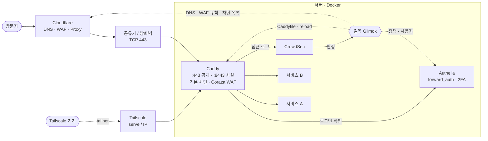
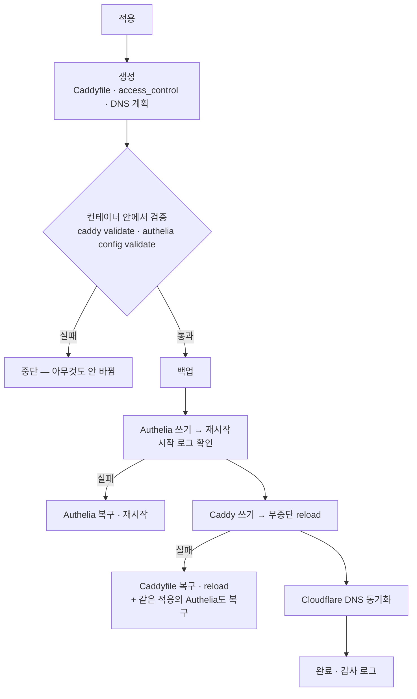

<div align="center">

# 길목 · Gilmok

**Caddy + Authelia + Cloudflare + CrowdSec + Tailscale 리버스 프록시를 웹 화면 하나로 관리합니다.**

서비스를 추가하면 Caddyfile·로그인 정책·DNS 레코드·WAF 규칙이 함께 만들어지고,<br>
**검증 → 백업 → 무중단 적용 → 상태 확인 → 실패하면 자동 롤백**까지 길목이 처리합니다.

[](LICENSE)

[](https://hub.docker.com/r/vitive/gilmok)


**한국어** · [English](README.en.md)

</div>

> **길목**: 넓은 길에서 좁은 길로 들어서는 어귀. 집 서버로 들어오는 모든 요청이 지나가는 그 자리를 관리한다는 뜻입니다.

---

## 목차

- [왜 만들었나](#왜-만들었나)
- [할 수 있는 일](#할-수-있는-일)
- [구성 한눈에 보기](#구성-한눈에-보기)
- [안전한 적용](#안전한-적용)
- [빠른 시작](#빠른-시작)
- [구성요소는 골라서](#구성요소는-골라서)
- [보안 모델](#보안-모델)
- [환경변수](#환경변수)
- [언어](#언어)
- [개발](#개발)
- [자주 묻는 질문](#자주-묻는-질문)
- [라이선스](#라이선스)

## 왜 만들었나

홈랩에 서비스가 열 개, 스무 개로 늘면 서비스 하나를 추가할 때마다 할 일이 많아집니다.

1. Caddyfile에 사이트 블록 추가 (공개? Tailscale 전용? mTLS?)
2. Authelia `access_control`에 규칙 추가, 필요하면 `users_database.yml` 수정
3. Cloudflare에 DNS 레코드 추가 (Proxied? DNS only? Tailscale IP?)
4. WAF·CrowdSec 같은 보호 설정
5. reload·restart 하고, 안 되면 원인 찾아 되돌리기

손으로 하면 하나만 빠뜨려도 사이트가 열리지 않거나, 더 나쁘게는 **로그인 없이 열립니다.**
길목은 이것을 **서비스 하나 = 설정 한 줄**로 묶고, 바뀌는 내용을 미리 보여 준 뒤 안전하게 적용합니다.

## 할 수 있는 일

### 서비스 (리버스 프록시)
- 서브도메인마다 **공개(:443) / 사설(Tailscale·VPN 전용)**, Cloudflare **Proxied / DNS only**, **mTLS**(인증된 원본 풀), Authelia **1단계/2단계 + 허용 그룹**, WAF 모드를 정합니다
- **엑셀(.xlsx)·CSV 일괄 등록** — 양식을 받아 채워 올리면 추가·수정·삭제를 미리 보여 주고 한 번에 반영
- **컨테이너에서 대상 고르기** — Docker 컨테이너와 포트를 목록에서 골라 `upstream`을 채움 (같은 네트워크인지, 게시 포트인지 판단)
- **구성도** — 인터넷 → Cloudflare → 공유기·방화벽 → Caddy → 서비스까지 실제 구성을 그림으로. 응답 없는 서비스는 흐름이 멈춘 점선으로

### Caddy
- 기존 Caddyfile **가져오기** (전역 옵션·스니펫 → 기본 골격, 사이트 → 서비스)
- 기본 골격(전역 옵션·스니펫)은 서비스와 분리 — **Caddy 이미지 업데이트를 따로** 적용
- **기본 차단**: 스캐너·공격 도구·AI 크롤러 User-Agent, `/.env` 같은 탐색 경로를 Caddy 앞단에서 403
- **Coraza WAF + OWASP CRS**: 서비스별 끔/탐지/차단, 민감도(paranoia), 점수 기준, 규칙 그룹·예외, 차단 기록·시험 요청
- 연결 방식 3가지: Docker 컨테이너 / Caddy 관리 API(:2019) / 같은 PC의 caddy 실행 파일

### Authelia
- 서비스별 `access_control` 규칙 생성 — `configuration.yml`의 **access_control 블록만 바꾸고** 주석·`{{ secret }}` 템플릿·OIDC·notifier는 건드리지 않음
- 사용자 관리(argon2id 해시)와 **그룹 미리 정의** — 허용 그룹은 등록된 것만 고르게 해 오타로 보호가 풀리는 일을 막음

### Cloudflare
- DNS 레코드 자동 동기화(생성·수정·삭제, Proxied 전환, Tailscale IP), 서비스와 관계없는 레코드 직접 편집
- **DDNS Updater** (IPv4·IPv6) — 공인 IP가 바뀌면 레코드 주소만 고침
- **엣지 WAF 규칙**: 신뢰 IP 허용, 위협 차단(스캐너·AI 크롤러·공격 경로를 규칙 하나로), 국가·통신사(ASN) 제한, 사용자 규칙, 속도 제한 — 플랜 한도 확인
- 엣지 이벤트(Cloudflare가 막은 요청) 보기

### CrowdSec (Cloudflare 연동형)
- mTLS 사이트의 접근 로그(Cloudflare가 넘긴 실제 IP)로 공격 IP를 판정 → **Cloudflare 엣지 IP 목록으로 차단**
- 서버가 접속자 IP를 볼 수 없는 Docker Desktop 같은 환경에서도 동작하는 방식 ([아래](#자주-묻는-질문) 참고)

### 관찰 · 운영
- **대시보드**: 분당 요청, 5xx 비율, 응답시간 p95, 상태코드별 추이, 응답시간 산점도(드래그로 요청 목록), 서비스 상태 맵, 컨테이너 리소스, 인증서 만료 — 위젯을 추가·편집·정렬
- **로그**: 감사(누가 무엇을 바꿨나), 보안·침입탐지, 시스템, 요청, 지표 — SQLite, 보존 기간·디스크 보호
- **이미지 업데이트 알림**과 앱 안 업데이트(compose 기반), 설정 백업·복원, 완전 초기화
- **관리형 스택**: Caddy·Authelia·CrowdSec이 아직 없으면 길목이 옆 컨테이너로 설치하고 연결까지 맞춤 (compose 직접 편집 가능)
- **첫 설정 마법사 / 빠른 설정**: 컨테이너·설정 파일·도메인·Tailscale IP를 자동으로 찾아 한 화면에서 시작

### 화면
- 다크 + 글래스모피즘, **시스템 / 다크 / 화이트** 테마, 키보드·스크린리더 접근성(포커스 트랩, ARIA)
- 빌드 도구 없는 Vanilla HTML/CSS/JS — 바이너리에 내장

## 구성 한눈에 보기



**설정의 원본은 길목의 데이터(`/data/gilmok.json`)** 입니다. Caddyfile과 Authelia `access_control` 블록은 길목이 *만듭니다*.
Caddyfile을 직접 고치면 다음 적용 때 덮어써집니다(파일 맨 위에 안내 배너가 들어갑니다). 전역 옵션·스니펫은 화면의 「기본 골격」에서 고칩니다.

## 안전한 적용

저장만으로는 아무것도 바뀌지 않습니다. 변경은 「적용 대기」에 쌓이고, **「적용」을 눌러 미리보기(diff + DNS 계획)를 확인한 뒤에만** 실제 파일·컨테이너·DNS가 바뀝니다.



- 단일 파일 bind mount(`./Caddyfile:/etc/caddy/Caddyfile`)에서도 안전하도록 **제자리 쓰기**(rename 하지 않음)
- 현재 파일을 읽지 못하면 되돌릴 원본이 없으므로 적용 자체를 중단
- 공개 레코드의 **주소가 바뀌는 DNS 변경은 기본 보류** — 길목이 다른 네트워크(테스트 PC 등)에서 돌 때 잘못된 IP로 바꾸는 사고를 막음
- 롤백 경로는 테스트 스택에서 장애를 일부러 주입해 확인했습니다 (`GM_DEV_FAULTS`, 테스트 스택 전용)

## 빠른 시작

이미지는 Docker Hub의 [`vitive/gilmok`](https://hub.docker.com/r/vitive/gilmok)입니다 (linux/amd64 · linux/arm64).

### 가장 간단하게 — 파일 하나

```bash
mkdir gilmok && cd gilmok
curl -fsSLO https://github.com/redstar-programmer/gilmok/releases/latest/download/docker-compose.yml
docker compose up -d
```

`.env` 없이 동작합니다. 빈 상태로 시작해 「빠른 설정」에서 Caddy·Authelia·CrowdSec을 새로 설치하거나, 파일 안의 주석을 풀어 이미 쓰는 Caddy·Authelia에 연결합니다. 이 파일은 저장소의 [`deploy/docker-compose.sample.yml`](deploy/docker-compose.sample.yml)과 같고, 릴리스마다 첨부됩니다.

### docker compose + .env (폴더·이름을 환경에 맞게)

```bash
mkdir -p ~/gilmok/secrets && cd ~/gilmok
curl -fsSLO https://raw.githubusercontent.com/redstar-programmer/gilmok/main/deploy/docker-compose.yml
curl -fsSL https://raw.githubusercontent.com/redstar-programmer/gilmok/main/deploy/.env.example -o .env
touch secrets/cf_token secrets/crowdsec_key    # 없으면 Docker가 폴더로 만들어 버림
$EDITOR .env                                   # Caddy·Authelia 폴더, 컨테이너 이름, 네트워크, 언어
docker network create reverseproxy 2>/dev/null || true
docker compose up -d
```

업데이트는 `docker compose pull && docker compose up -d`. 버전을 고정하려면 `.env`의 `GM_IMAGE=vitive/gilmok:0.2.0`처럼 씁니다.

<details>
<summary>소스에서 직접 빌드하려면</summary>

```bash
git clone https://github.com/redstar-programmer/gilmok.git src
cp src/deploy/docker-compose.build.yml .
docker compose -f docker-compose.yml -f docker-compose.build.yml up -d --build   # 빌드하면서 go test도 돎
```
</details>

### Windows 설치 스크립트 (Docker Desktop)

```powershell
git clone https://github.com/redstar-programmer/gilmok.git D:\src\gilmok
cd D:\src\gilmok
powershell -ExecutionPolicy Bypass -File .\deploy\install.ps1 -Target D:\Docker\gilmok `
    -CaddyDir D:\Docker\caddy -AutheliaDir D:\Docker\authelia -CaddyContainer caddy -Network reverseproxy
```

Docker Hub 이미지를 받아 띄웁니다(`-Build`면 소스에서 빌드). 넘긴 옵션은 `.env`에 저장되어, 다음부터는 `install.ps1 -Target D:\Docker\gilmok`만 다시 실행하면 업데이트됩니다. 자세한 내용은 [deploy/README.md](deploy/README.md).

### 첫 접속

1. 서버에서 **http://127.0.0.1:8088** — 관리 화면은 기본으로 `127.0.0.1`에만 열립니다
2. **언어 선택** (한국어 / English) — 이 설치의 모든 화면이 그 언어로 나옵니다 (`GM_LANG`으로 미리 정하면 건너뜀, 나중에 설정 탭에서 변경)
3. `admin` / `admin`으로 로그인 → 바로 **본인 관리자 계정**을 만들고, 초기 계정은 즉시 비활성화됩니다
4. **빠른 설정** 또는 **설정 마법사** — 컨테이너·Caddyfile·Authelia 설정·도메인·Tailscale IP를 자동으로 찾아 제안합니다. Caddy·Authelia·CrowdSec이 없다면 여기서 새로 설치할 수도 있습니다
5. 서비스를 확인하고 「적용」 → 미리보기 → 적용
6. (선택) 휴대폰에서도 쓰려면 길목 자신을 Tailscale 전용 + Authelia 2단계 사이트로 등록 (설정 › 접근 보안 › 길목 사이트 만들기)

## 구성요소는 골라서

모든 구성요소가 필요하지 않습니다. 설정 › 구성요소에서 쓰는 것만 켜면, 나머지는 탭·설정·적용 단계가 숨겨지고 길목이 건드리지 않습니다.

| 조합 예 | 길목이 하는 일 |
|---|---|
| Caddy만 | Caddyfile 생성·검증·무중단 적용, 기본 차단·WAF, 대시보드 |
| Caddy + Authelia | 위 + 서비스별 로그인 관문·정책·사용자 |
| Caddy + Cloudflare | 위 + DNS 자동화·DDNS·엣지 WAF 규칙·mTLS |
| Cloudflare만 | DNS 레코드·DDNS·엣지 규칙 관리 |
| 전부 + CrowdSec + Tailscale | 판정은 CrowdSec, 차단은 Cloudflare 엣지, 사설 사이트는 Tailscale |

보호가 빠지는 전환(mTLS 서비스가 있는데 Cloudflare를 끄는 등)은 빨간 경고로 한 번 더 묻습니다.

## 보안 모델

길목은 프록시·SSO·DNS·WAF를 모두 바꿀 수 있는 도구라 여러 겹으로 막습니다.

| 층 | 내용 |
|---|---|
| 접근 경로 | 호스트 포트 직접(127.0.0.1) 또는 Caddy가 길목 사이트에만 붙이는 **비밀 헤더**가 있는 요청만 — 같은 Docker 네트워크의 다른 컨테이너는 거부 |
| SSO | Caddy를 거쳐 오면 Authelia의 `Remote-User` 필수, 허용 그룹 지정 |
| 계정·역할 | 사람마다 계정, 관리자 / 운영자 / 보기 전용 + 사용자 역할, 권한 7종 |
| 2단계 인증 | TOTP + 복구 코드, 계정별 요구, 같은 코드 재사용 거부 |
| 재인증 | 적용·사용자 변경·로그 삭제·보안 설정은 N분 안에 비밀번호 재확인 |
| 잠금 | 계정·IP별 + 전역 지수 잠금 |
| 감사 | 모든 쓰기 작업을 누가·무엇을·전후 값으로 기록 (비밀값은 `***`) |
| 비밀값 | 토큰·해시·세션 시크릿은 응답·로그에 나오지 않음 |

> ⚠ 관리 화면을 **인터넷에 직접 공개하지 마세요.** 원격 접속은 사설망(Tailscale 등) + Authelia 사이트를 권장합니다.
> 길목은 Docker 소켓에 접근하므로, 길목 계정은 곧 서버 관리 권한입니다.

침투 테스트 시나리오(접근 경로 우회, 권한 상승, 잠금 회피, 세션 위조, 인젝션, 비밀 노출)가 [자동 테스트](docs/TEST_SCENARIOS.md)로 들어 있습니다.

## 환경변수

처음 시작할 때의 기본값입니다. 이후에는 화면의 설정이 원본입니다. compose에서는 `.env`로 넣습니다 (`GM_IMAGE`로 이미지·버전도 고름).

| 변수 | 기본값 | 설명 |
|---|---|---|
| `GM_DATA` | `/data` | 데이터 폴더 (설정·로그 DB·백업·관리형 스택) |
| `GM_LISTEN` | `:8080` | 길목이 듣는 주소 |
| `GM_LANG` | | 화면 언어 `ko` / `en` — 비우면 첫 접속에서 고름 |
| `GM_DOMAIN` | | 기본 도메인 (예: `example.com`) |
| `GM_TAILSCALE_IP` | | 사설 서비스의 DNS 값 (예: `100.64.0.10`) |
| `GM_CADDY_CONTAINER` / `GM_AUTHELIA_CONTAINER` / `GM_CROWDSEC_CONTAINER` | `caddy` / `authelia` / `crowdsec` | 컨테이너 이름 |
| `GM_CADDYFILE` | | 길목이 읽고 쓰는 Caddyfile 경로 |
| `GM_AUTHELIA_CONFIG` / `GM_AUTHELIA_USERS` | | Authelia `configuration.yml` / `users_database.yml` |
| `GM_CROWDSEC_LAPI` | | CrowdSec LAPI 주소 (예: `http://crowdsec:8080`) |
| `GM_CF_TOKEN_FILE` / `GM_CF_TOKEN` | | Cloudflare API 토큰 (파일 권장). 없으면 화면에서 입력 |
| `GM_CROWDSEC_KEY_FILE` / `GM_CROWDSEC_KEY` | | CrowdSec 바운서 키. 없으면 화면에서 만듦 |
| `GM_SELF_CONTAINER` | 자동 | 길목 자신의 컨테이너 이름 (자동 감지 실패 시) |

Cloudflare 토큰 권한: `Zone · Zone · Read`, `Zone · DNS · Edit` (+ WAF 규칙: `Zone · Zone WAF · Edit`, 엣지 이벤트: `Zone · Analytics · Read`, CrowdSec 목록: `Account · Account Filter Lists · Edit`). 저장 전에 실제로 조회해 확인합니다.

## 언어

화면은 **한국어** 와 **English**를 지원합니다. 언어는 **설치 단위 설정**입니다 — 처음 접속할 때 고르면(또는 `GM_LANG`) 그 설치의 모든 사용자가 그 언어로 보고, 나중에 **설정 탭 › 화면 언어**에서 바꿉니다.

- 원문(한국어)이 메시지 ID입니다 (gettext 방식). `web/i18n/ko.json`은 소스에서 자동으로 뽑은 원문 목록, `web/i18n/en.json`은 번역입니다
- **새 언어 추가**: `ko.json`을 `xx.json`으로 복사해 값을 번역하고, `web/i18n.js`의 `LANGS`에 이름을 넣으면 됩니다

```bash
go run ./tools/i18n              # 소스에서 ko.json 다시 만들기 + 번역률 보고
go run ./tools/i18n -missing en  # 아직 번역 안 된 문구
go run ./tools/i18n -sync        # 소스에서 사라진 번역 정리
```

## 개발

```bash
go test ./...                                             # 단위 · 시나리오 · 침투 테스트
bash dev/reset.sh                                         # 테스트 스택 데이터 만들기 (dev/run, git 제외)
docker compose -f dev/docker-compose.yml up -d --build    # http://127.0.0.1:18088
```

테스트 스택은 실제 Caddy(Coraza 포함)·Authelia·CrowdSec 컨테이너를 다른 이름으로 띄웁니다. `local_certs`라 외부 호출이 없습니다.

```
.
├── *.go                 백엔드 (단일 바이너리, Go 1.22+ ServeMux)
│   ├── apply.go         적용 파이프라인 · 롤백
│   ├── caddy.go         Caddyfile 가져오기 · 생성
│   ├── authelia.go      access_control · 사용자
│   ├── cloudflare.go    DNS · cfwaf.go 엣지 규칙 · ddns.go
│   ├── crowdsec.go      LAPI → Cloudflare 목록 동기화
│   ├── stacks*.go       관리형 스택 (옆 컨테이너 설치)
│   └── security.go      접근 경로 · 세션 · 잠금 · accounts.go 계정·역할·TOTP
├── web/                 화면 (Vanilla JS, embed) · web/i18n 언어 파일
├── tools/i18n/          원문 목록 추출 도구
├── deploy/              배포 compose · install.ps1 · Caddy(Coraza) Dockerfile · CrowdSec 파서
├── dev/                 테스트 스택
└── docs/                설계 문서 · 테스트 시나리오
```

### 릴리스 (관리자용)

`git tag v0.2.0 && git push origin v0.2.0` → GitHub Actions(`.github/workflows/docker.yml`)가 테스트 후 amd64·arm64 이미지를 `vitive/gilmok:0.2.0`, `:0.2`, `:latest`로 올립니다. 저장소 Secrets에 `DOCKERHUB_USERNAME`, `DOCKERHUB_TOKEN`(Docker Hub 액세스 토큰, Read & Write)이 필요합니다. 모든 push에는 `test.yml`이 `go vet`·`go test`와 원문 목록(ko.json) 최신 여부를 확인합니다.

## 자주 묻는 질문

<details>
<summary><b>Docker Desktop에서 접속자 IP가 전부 172.x로 보입니다</b></summary>

Docker Desktop(Windows·macOS)은 외부 접속자 IP를 브리지 게이트웨이로 바꿉니다. 그래서 서버 안에서 IP로 판단하는 기능(GeoIP, fail2ban, rate limit, IP allowlist)은 쓸 수 없습니다.
길목은 IP 기반 차단을 **Cloudflare 엣지**에서 합니다. CrowdSec은 Cloudflare만 접속할 수 있는 mTLS 사이트의 로그에서 `Cf-Connecting-Ip`(위조 불가)로 판정하고, 차단은 Cloudflare IP 목록으로 보냅니다. DNS only 사이트에는 이 헤더를 믿지 않습니다.
</details>

<details>
<summary><b>이미 쓰고 있는 Caddyfile을 그대로 쓸 수 있나요?</b></summary>

「기존 설정 가져오기」가 전역 옵션·스니펫을 기본 골격으로, 사이트 블록을 서비스로 바꿉니다. 실제 파일은 바뀌지 않고, 「적용」 전에 diff로 차이를 확인할 수 있습니다. 처음에는 주석·구역 제목 차이가 보이는 것이 정상입니다.
</details>

<details>
<summary><b>Authelia 설정의 다른 부분(OIDC, notifier)이 망가지지 않나요?</b></summary>

길목은 `configuration.yml`에서 `access_control:` 블록만 텍스트로 바꿉니다. 주석, `{{ secret }}` 템플릿, OIDC, notifier는 그대로 둡니다. 바꾼 결과는 Authelia 컨테이너 안에서 `authelia config validate`로 먼저 검증합니다.
</details>

<details>
<summary><b>nginx Proxy Manager / Traefik도 되나요?</b></summary>

지금은 Caddy만 지원합니다. nginx는 이후 계획에 있습니다.
</details>

<details>
<summary><b>리눅스에서도 동작하나요?</b></summary>

Docker 이미지라 리눅스에서도 동작합니다(이름 있는 볼륨의 `/data`, `host.docker.internal` 등 확인). 다만 SELinux(`:z` 라벨)와 리눅스용 설치 스크립트는 아직 확인하지 못했습니다 — 위의 compose 방법을 쓰세요.
</details>

## 앞으로

- 연결형 → 관리형 스택 이전
- nginx 지원
- Sablier 연동 (유휴 컨테이너 자동 정지/시작)

## 라이선스

[MIT](LICENSE) — 누구나 자유롭게 쓰고, 고치고, 다시 배포할 수 있습니다.
